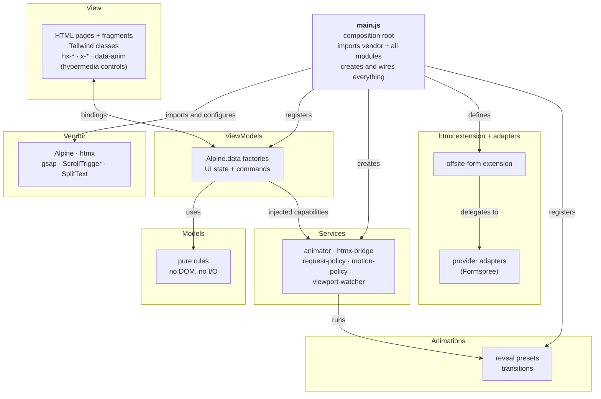
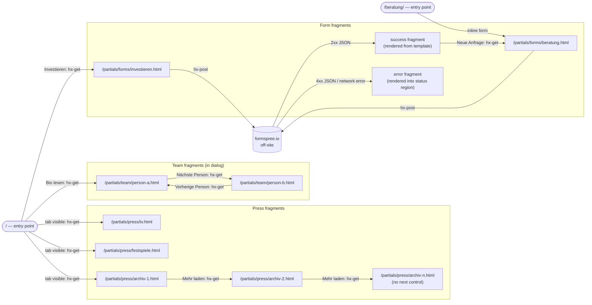
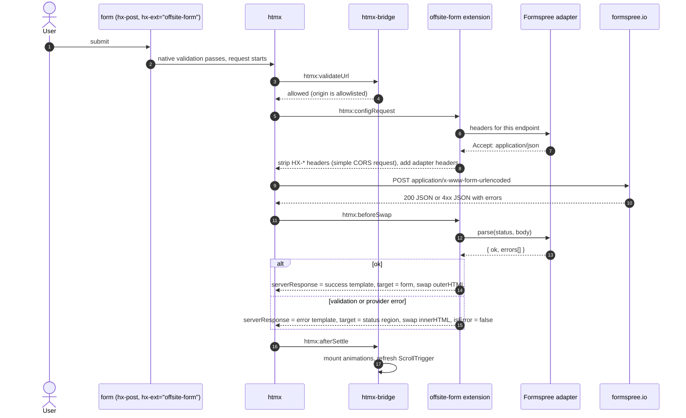
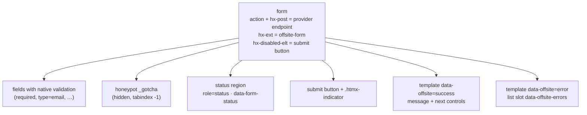
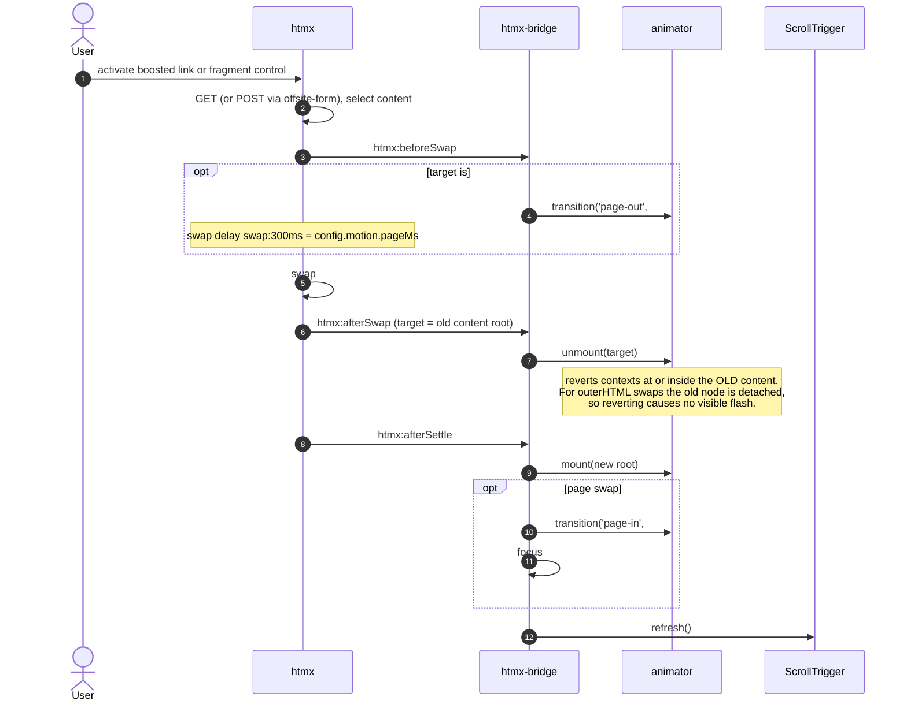
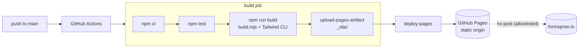

# Architecture

This document describes the overall architecture of the MyPilz-style site rebuild. The
coding rules live in [coding.md](./coding.md). The page UI/UX specification lives in
[site.md](./site.md). All diagrams are Mermaid and render on GitHub.

---

## 1. Purpose and scope

The goal is a static marketing site that reproduces the look and feel of mypilz.eu. The
original is a WordPress site using the Salient theme. The rebuild uses a small, explicit
front-end architecture driven by hypermedia:

- **htmx fragments and HATEOAS** for everything loaded or changed after the first page
  view;
- **off-site services** (Formspree first) for anything that needs a server.

**In scope (v1)**

- Pages: Home, Services, Beratung (contact), Impressum, Datenschutz, 404.
- Hero and closing sections with background videos.
- Header with a mega-menu (desktop) and an off-canvas menu (mobile).
- Team bios in a modal dialog, with previous/next navigation inside the dialog.
- Press section with tabs. Panels other than the first are lazy-loaded, and the archive
  is paginated with a "Mehr laden" button.
- Partner logo marquee, testimonial carousel and rotating-word band.
- Page transitions between internal pages, with a header that persists.
- **Forms through Formspree:**
  - the consultation request on `/beratung/`;
  - the investment enquiry, opened in the shared dialog.

**Out of scope (v1, YAGNI)**

These are not built until there is a concrete need:

- Webshop and cart.
- Blog.
- Research and festival pages.
- Translations.
- Newsletter signup through our own form. It needs double opt-in, so it links to the
  provider's hosted signup page.
- Analytics and cookie consent.
- A CMS.
- Our own serverless functions.

Where the original links to these, the rebuild either links out to an external URL or
leaves the link off.

## 2. Constraints

| Constraint | Consequence |
|---|---|
| Hosting is GitHub Pages | Our origin serves static files only: no server code, no custom HTTP headers, no redirects. Our own resources are fetched with GET. **Dynamic behaviour goes to allowlisted off-site services over HTTPS**, for example a POST to Formspree (§7). |
| Stack: htmx, Alpine.js, Tailwind CSS, Google Fonts, GSAP | Each library has exactly one job (§4.3). No other runtime libraries are added. |
| Hypermedia-driven (htmx fragments + HATEOAS) | The client is driven by the HTML it receives. Every URL beyond the entry pages arrives inside a hypermedia control (§6). |
| No custom CSS where a Tailwind equivalent exists | Styling lives in class attributes. `src/css/app.css` contains only theme tokens, `@font-face`, custom variants and the documented exceptions in coding.md §6. |
| ES6 modules, no bundler | The browser loads native ES modules. Vendor ESM builds are copied into `/vendor/` at build time. |
| IoC via `main.js` | `main.js` is the only composition root. It is the only module that imports concrete implementations, creates objects and touches globals. |
| MVVM | The View is HTML. ViewModels are Alpine components. Models are pure rules. Services, extensions and adapters wrap side effects. |
| SOLID, YAGNI, KISS | See §3 for how each principle is applied. |

## 3. Principles in practice

**Single Responsibility.** Each module has one reason to change:

- An animation preset changes when that animation changes.
- The animator changes when the mount/unmount lifecycle changes.
- The htmx bridge changes when the swap lifecycle changes.
- The request policy changes when the list of allowed origins changes.
- A provider adapter changes when that provider's API changes.
- A ViewModel changes when its component's behaviour changes.

**Open/Closed.** Adding an animation means writing a preset and registering it in
`main.js`. Adding an off-site provider means writing an adapter and registering it in
`main.js`. Neither the animator nor the `offsite-form` extension changes.

**Liskov Substitution.** Any object that satisfies a contract in `src/js/contracts.js` can
replace another. For example, a test fake can replace the GSAP animator, and any provider
adapter (Formspree, Getform, a future own endpoint) can replace another.

**Interface Segregation.** Consumers receive only the capability they use:

- A ViewModel that needs to animate receives `transition(name, el)`, not the whole
  animator.
- The extension receives adapters, not the request policy.
- The bridge receives `requestPolicy.allows`, not the whole configuration.

**Dependency Inversion.** Modules depend on the JSDoc contracts. `main.js` binds those
contracts to concrete implementations. Vendor libraries (gsap, ScrollTrigger, SplitText,
htmx, Alpine) are also injected. Only `main.js` imports them.

**YAGNI.**

- No DI container library: `main.js` wires dependencies by hand ("pure DI").
- No client-side templating engine.
- No state store.
- No router.
- No i18n layer.
- No TypeScript build. JSDoc plus `// @ts-check` gives editor type checking without a
  compiler.
- No backend of our own while a hosted service covers the need.

**KISS.**

- Content and state transitions are HTML, not JSON rendered by JavaScript.
- The build is a single script plus the Tailwind CLI.
- No bundler and no import maps. `main.js` imports vendor files by path.

## 4. System overview

### 4.1 Runtime layers (MVVM)



**Dependency rule.** Dependencies point away from `main.js` and never back. Models import
nothing. Animations, services, extensions, adapters and ViewModels import only `lib/`
helpers and JSDoc types. Nothing imports `main.js`.

### 4.2 Layer definitions

| Layer | Location | Responsibility | Must not |
|---|---|---|---|
| View | `src/**/*.html`, `src/_includes/`, `src/partials/` | Semantic structure, content, Tailwind styling and **hypermedia controls** (`a[href]`, `hx-get`, `hx-post`). Declares bindings (`x-data`, `@click`) and animation hooks (`data-anim`). | Contain logic beyond a member reference or call. Contain inline `<script>` or `style=""`. |
| ViewModel | `src/js/viewmodels/` | Holds UI-only state (open, active tab, index), exposes commands to the View and calls injected services. | Hold URLs. Fetch data. Import vendor libraries. Query outside its own `$el`/`$refs`. |
| Model | `src/js/models/` | Pure UI rules, such as carousel index wrapping or tab order. | Touch the DOM, timers, globals or I/O. |
| Service | `src/js/services/` | Wraps side effects behind small contracts: animation lifecycle, htmx lifecycle, request policy, motion preferences, viewport visibility. | Know about specific components. |
| htmx extension | `src/js/extensions/` | Adapts htmx requests and responses for a class of endpoints. For example, `offsite-form` turns JSON from off-site services into hypermedia. | Know about a specific provider. Providers live in adapters. |
| Adapter | `src/js/adapters/` | Translates one provider's protocol (headers, status, JSON shape) into the `OffsiteAdapter` contract. | Touch the DOM. |
| Animation | `src/js/animations/` | Declarative reveal presets (keyed by `data-anim`) and imperative transitions (keyed by name). They receive GSAP through injection. | Import gsap. |
| Lib | `src/js/lib/` | Tiny pure helpers. | Have side effects. |
| Composition root | `src/js/main.js` | Wires everything and boots. | Contain business or UI logic. |

### 4.3 Library ownership

There is exactly one owner per concern.

| Concern | Owner | Notes |
|---|---|---|
| Structure, content and available actions | HTML (hypermedia) | Pages are built by the build step (includes). Fragments are pre-rendered `.html` files. |
| Static styling and responsive layout | Tailwind | Utility classes plus `@theme` tokens. |
| Fetching, submitting and navigating | htmx | `hx-boost` navigation, `hx-get` fragments, `hx-post` to allowlisted off-site services. |
| Client-side UI state | Alpine | Open/closed, active tab, carousel index, ARIA state. |
| Anything that moves, fades, scrolls or is sequenced | GSAP | Includes show/hide transitions. Alpine `x-transition` is not used. |
| Fonts | Google Fonts | Self-hosted `.woff2` files downloaded from Google Fonts (§12). |

## 5. Composition root

`src/js/main.js` is the single source of truth for object creation. The sketch below is
normative for the structure.

```js
// @ts-check
// src/js/main.js — composition root. The ONLY module that imports concrete
// implementations, touches globals, and creates objects.

// ── Vendor (copied to /vendor by the build; imported by path, no import map) ──
import Alpine from '/vendor/alpinejs/module.esm.js';
import htmx from '/vendor/htmx/htmx.esm.js';
import gsap from '/vendor/gsap/index.js';
import { ScrollTrigger } from '/vendor/gsap/ScrollTrigger.js';
import { SplitText } from '/vendor/gsap/SplitText.js';

// ── App modules (factories and definitions only, no side effects on import) ──
import { config } from './config.js';
import { createMotionPolicy } from './services/motion-policy.js';
import { createViewportWatcher } from './services/viewport-watcher.js';
import { createRequestPolicy } from './services/request-policy.js';
import { createAnimator } from './services/animator.js';
import { createHtmxBridge } from './services/htmx-bridge.js';
import { createOffsiteFormExtension } from './extensions/offsite-form.js';
import { createFormspreeAdapter } from './adapters/formspree.js';
import { revealPresets } from './animations/presets/index.js';
import { transitionPresets } from './animations/transitions/index.js';
import { createCarouselModel } from './models/carousel.js';
import { createTabsModel } from './models/tabs.js';
import { createDisclosureViewModel } from './viewmodels/disclosure.js';
import { createSiteHeaderViewModel } from './viewmodels/site-header.js';
import { createTabsViewModel } from './viewmodels/tabs.js';
import { createDialogViewModel } from './viewmodels/dialog.js';
import { createCarouselViewModel } from './viewmodels/carousel.js';
import { createAmbientVideoViewModel } from './viewmodels/ambient-video.js';

// ── 1. Configure vendor ──
gsap.registerPlugin(ScrollTrigger, SplitText);
gsap.defaults({ ease: config.motion.ease, duration: config.motion.duration });
Object.assign(htmx.config, config.htmx);

// ── 2. Services ──
const motion = createMotionPolicy({
  matchMedia: (q) => window.matchMedia(q),
  connection: /** @type {any} */ (navigator).connection,
});
const watchViewport = createViewportWatcher({ ScrollTrigger });
const requestPolicy = createRequestPolicy({
  ownOrigin: window.location.origin,
  allowedOrigins: config.offsite.allowedOrigins,
});
const animator = createAnimator({
  gsap,
  plugins: { ScrollTrigger, SplitText },
  presets: revealPresets,
  transitions: transitionPresets,
  motion,
  debug: config.debug,
});
const transition = animator.transition; // ISP: ViewModels get only this capability

// ── 3. htmx extension for off-site services (OCP: add adapters, not code) ──
htmx.defineExtension('offsite-form', createOffsiteFormExtension({
  htmx,
  adapters: [createFormspreeAdapter()],
  messages: config.messages.offsite,
}));

// ── 4. ViewModels (Alpine calls these factories once per component instance) ──
Alpine.data('disclosure', (enter = 'menu-in', leave = 'menu-out') =>
  createDisclosureViewModel({ transition, enter, leave }));
Alpine.data('siteHeader', () =>
  createSiteHeaderViewModel({ currentPath: () => window.location.pathname }));
Alpine.data('tabs', (ids, initial) =>
  createTabsViewModel({ model: createTabsModel({ ids }), initial, transition }));
Alpine.data('dialog', (enter = 'dialog-in', leave = 'dialog-out') =>
  createDialogViewModel({ transition, enter, leave }));
Alpine.data('carousel', (count) =>
  createCarouselViewModel({ model: createCarouselModel({ count }), transition }));
Alpine.data('ambientVideo', () => createAmbientVideoViewModel({ motion, watchViewport }));

// ── 5. Lifecycle wiring ──
createHtmxBridge({
  htmx,
  animator,
  allowsUrl: requestPolicy.allows,
  refreshScroll: () => ScrollTrigger.refresh(),
  document,
  selectors: config.selectors,
  messages: config.messages.fragment,
}).start();

// ── 6. Boot ──
Alpine.start();
for (const sel of config.selectors.mountRoots) {
  const root = document.querySelector(sel);
  if (root) animator.mount(root);
}
document.fonts.ready.then(() => ScrollTrigger.refresh());
document.documentElement.dataset.app = 'ready';
```

**Rules for `main.js`**

- It contains no conditionals about UI behaviour. Behaviour belongs in ViewModels,
  presets, services, extensions and adapters.
- Plugins, the htmx extension and every `Alpine.data` registration are here and only
  here.
- `config.js` holds no navigation URLs. Off-site endpoints live in the form markup (§6).
  The only URLs in config are the **origin allowlist**, which is a security policy.
- When `main.js` grows past roughly 150 lines, split the wiring into `wire-*.js`
  functions that receive `{ deps }`. They are still called only from `main.js`.

### 5.1 Pre-boot shim

`src/js/boot.js` is a classic, non-module script loaded synchronously in `<head>`. It is
the one documented exception to "only main.js touches globals". It exists so elements
that will be animated can start hidden before first paint.

```js
// src/js/boot.js — classic script, loaded sync in <head>. No imports.
document.documentElement.classList.add('js');
setTimeout(() => {
  // Failsafe: if main.js failed, show all content.
  if (document.documentElement.dataset.app !== 'ready') {
    document.documentElement.classList.remove('js');
  }
}, 4000);
```

Elements that start hidden carry the class `js:invisible`, a custom variant defined in
coding.md §6. Without JavaScript, or if JavaScript fails, everything is visible.

## 6. Hypermedia model (htmx fragments + HATEOAS)

### 6.1 What HATEOAS means on a static host

The "server" is the build output plus off-site services. Every state the user can reach is
a pre-rendered HTML document or fragment. The available next actions are expressed as
hypermedia controls *inside* that HTML. Because the host is static, the state graph is
finite and is enumerated when the site is authored. HATEOAS still holds: the client never
decides which actions or URLs exist. The HTML it received tells it.

### 6.2 Rules

1. **Entry points only.** The client knows the page URLs, through ordinary links. Every
   other URL reaches it inside a control, such as `a[href]`, `hx-get`, `hx-post` or a
   form `action`, in HTML it has already received.
2. **JavaScript never builds, stores or concatenates URLs.** ViewModels hold no URLs.
   `config.js` holds no navigation URLs.
3. **Fragments are self-describing.** A fragment carries the controls for every legal
   next action, and only those. A missing control means the action is not available. For
   example, the last archive page has no "Mehr laden" button.
4. **The DOM is the application state.** Alpine state is UI-only: open/closed, active
   tab, carousel index. The client keeps no parallel model of server resources.
5. **Prefer replacing the control with its result.** A "Mehr laden" button swaps itself
   (`hx-target="this" hx-swap="outerHTML"`) for the next cards plus the next button.
6. **Off-site JSON is converted into hypermedia at the edge.** When a service answers
   with JSON, the `offsite-form` extension renders a hypermedia response from templates
   that ship *inside the form fragment* (§7). The client still only ever swaps HTML that
   contains its next controls.

### 6.3 State graph (v1)



### 6.4 Fragment contract

- A fragment is a plain HTML file under `src/partials/`. It has no `<html>`, `<head>`,
  `<body>`, `<script>` or `<style>`, and it has a single root element.
- It contains its own hypermedia controls for the next actions (rule 3), its own
  `data-anim` hooks, and, for forms, its own `<template>` elements for result states
  (§7.3).
- It is styled with the same Tailwind classes as pages. Tailwind scans `src/partials/`.
- `robots.txt` disallows `/partials/`. Fragments are not pages.

## 7. Off-site services

### 7.1 Principle

Our origin is static. Anything that needs a server, such as receiving a form, is handled
by an **allowlisted off-site service**. The browser calls it with htmx (`hx-post`) and the
response is turned into hypermedia by the `offsite-form` extension. ViewModels never call
`fetch`.

| Concern | Module | Notes |
|---|---|---|
| Which origins may be called | `services/request-policy.js` | `allows(url)` returns true for our own origin and for `config.offsite.allowedOrigins` (initially `https://formspree.io`). The bridge cancels everything else on `htmx:validateUrl`. |
| Protocol of a provider | `adapters/<provider>.js` | Implements the `OffsiteAdapter` contract (§9): `matches(url)`, request `headers`, and `parse(status, body)` → `{ ok, errors[] }`. |
| JSON → hypermedia | `extensions/offsite-form.js` | Provider-agnostic. Selects the adapter, prepares the request, then renders the success or error template from the form fragment and tells htmx where to swap it. |
| Endpoint URL | The form markup (`hx-post`, `action`) | Follows the HATEOAS rule. Never in JavaScript. |

### 7.2 Request and response flow



A network failure (`htmx:sendError`) has no response to swap. In that case the extension
renders the error template with a generic message into the status region, using
`htmx.swap()`.

### 7.3 Form fragment anatomy



- **Progressive enhancement:** the form keeps `action` and `method="post"`. Without
  JavaScript it posts natively and the provider shows its own confirmation page.
- **Security:** the extension writes provider messages with `textContent` only. Provider
  text never goes through `innerHTML`.
- **Spam:** use Formspree's `_gotcha` honeypot field. Do not use a CAPTCHA script,
  because it would load third-party code before consent.

### 7.4 Adding a provider or use case

- **New use case on the same provider:** create a new form fragment, with a new Formspree
  form id in its `hx-post` and `action`. No JavaScript changes.
- **New provider:** add `adapters/<provider>.js`, register it in `main.js`, add its
  origin to `config.offsite.allowedOrigins` and to the CSP (coding.md §10), and update
  Datenschutz (§12).

## 8. Runtime lifecycle

### 8.1 Initial load

1. The browser parses the HTML. Header, `#page` and footer are present, fully rendered by
   the build.
2. `boot.js` adds `.js` to `<html>`. Elements with `data-anim` that should start hidden
   become `invisible`.
3. `app.css` (Tailwind output) and the preloaded fonts and hero poster load.
4. `main.js` runs as a deferred module:
   - It configures vendor libraries and defines the htmx extension.
   - It creates services and registers ViewModels.
   - It starts the bridge and calls `Alpine.start()`.
   - It mounts animations per root (`header`, `#page`, `footer`).
5. When `document.fonts.ready` resolves, `ScrollTrigger.refresh()` runs. SplitText
   re-splits automatically through `autoSplit`.

### 8.2 Animation roots and the htmx swap lifecycle

The animator keeps a `Map<rootElement, gsap.MatchMedia>`. A **mount root** is any element
whose content is replaced as a unit:

- the header and footer (mounted once and never swapped);
- `#page` (replaced on boosted navigation);
- every htmx swap target, including form status regions and "Mehr laden" slots.



`unmount(root)` reverts every registered context whose key is `root` or is contained in
`root`. This also cleans up nested fragment contexts when the page they lived in is
replaced.

Alpine needs no bridge. Its MutationObserver initialises components in inserted HTML and
calls `destroy()` on components that are removed.

> **Verify during implementation** against the pinned htmx 2.x version, and encode each
> result as a test in `test/`:
> - `htmx:beforeSwap` fires before the `swap:` delay.
> - `beforeSwap` may override `serverResponse`, `target`, `swapOverride`, `shouldSwap`
>   and `isError`.
> - `htmx:responseError` is not raised when `isError` is set to false.
> - `htmx:validateUrl` fires for cross-origin requests when `selfRequestsOnly` is
>   `false`.
> - htmx focuses an element with `autofocus` in newly swapped content on settle.
>   coding.md §9 relies on this.

### 8.3 Navigation (hx-boost)

Boosting is declared on **link-only containers**: the header nav, the footer nav and
in-content CTA groups. Each such container carries the same attribute set, which lives
once in the include files:

```html
<nav hx-boost="true" hx-target="#page" hx-select="#page" hx-swap="outerHTML swap:300ms">
```

- The header is outside `#page`, so it persists across navigations. `siteHeader` updates
  `aria-current` from the URL.
- htmx updates `<title>` from the response. Other `<head>` meta stays stale in the
  browser, which is acceptable because crawlers fetch full pages.
- History: `historyCacheSize: 0` and `refreshOnHistoryMiss: true`. Back and forward do a
  full page load, which avoids restoring snapshots polluted with GSAP inline styles and
  Alpine state.
- External links, `mailto:`, downloads and `#anchor` links are not boosted.

## 9. Contracts

`src/js/contracts.js` contains only JSDoc typedefs.

```js
/**
 * @typedef {Object} MotionPolicy
 * @property {Record<string,string>} conditions   // for gsap.matchMedia: { reduced: '(prefers-reduced-motion: reduce)', full: '(prefers-reduced-motion: no-preference)' }
 * @property {() => boolean} prefersReduced
 * @property {() => boolean} saveData
 */

/**
 * @typedef {Object} RequestPolicy
 * @property {(url: URL) => boolean} allows       // own origin or allowlisted off-site origin
 */

/**
 * @typedef {Object} OffsiteResult
 * @property {boolean} ok
 * @property {{ field?: string, message: string }[]} errors
 */

/**
 * @typedef {Object} OffsiteAdapter              // one per provider
 * @property {string} name
 * @property {(url: URL) => boolean} matches
 * @property {Record<string,string>} headers     // CORS-safelisted only, e.g. { Accept: 'application/json' }
 * @property {(status: number, body: string) => OffsiteResult} parse
 */

/**
 * @typedef {Object} RevealContext
 * @property {any} gsap
 * @property {any} ScrollTrigger
 * @property {any} SplitText
 * @property {boolean} reduced
 * @property {{ add: (fn: Function) => void }} ctx   // gsap context: wrap tweens created in callbacks
 */

/**
 * @typedef {Object} RevealPreset            // declarative, selected by data-anim="<name>"
 * @property {string} name
 * @property {(targets: HTMLElement[], c: RevealContext) => void} setup
 */

/**
 * @typedef {Object} TransitionPreset        // imperative, called by ViewModels and the bridge
 * @property {string} name
 * @property {(el: HTMLElement, c: { gsap: any, reduced: boolean, options: object }) => any} run
 */

/** @typedef {(name: string, el: HTMLElement, options?: object) => Promise<void>} Transition */

/**
 * @typedef {Object} Animator
 * @property {(root: Element) => void} mount
 * @property {(root: Element) => void} unmount
 * @property {Transition} transition
 */

/** @typedef {(el: Element, onChange: (visible: boolean) => void) => () => void} WatchViewport */
```

## 10. Directory layout

```
.
├── AGENTS.md
├── docs/
│   ├── architecture.md
│   ├── coding.md
│   └── site.md
├── package.json              # devDependencies only, exact versions
├── package-lock.json
├── scripts/
│   └── build.mjs             # copy src → _site, expand includes, copy vendor
├── .github/workflows/pages.yml
├── test/                     # node --test; models, viewmodels, services, adapters, extension
├── src/
│   ├── index.html
│   ├── services/index.html
│   ├── beratung/index.html
│   ├── impressum/index.html
│   ├── datenschutz/index.html
│   ├── 404.html
│   ├── robots.txt            # Disallow: /partials/
│   ├── sitemap.xml
│   ├── _includes/            # build-time only, NOT deployed
│   │   ├── header.html
│   │   ├── footer.html
│   │   └── dialog.html
│   ├── partials/             # runtime htmx fragments (hypermedia), deployed
│   │   ├── press/            # tv.html, festspiele.html, archiv-1.html, archiv-2.html, …
│   │   ├── team/             # <slug>.html (with prev/next controls)
│   │   ├── media/            # <slug>.html (video player markup)
│   │   └── forms/            # beratung.html, investieren.html (with result templates)
│   ├── css/app.css           # Tailwind input (tokens, font-face, variants)
│   ├── fonts/                # self-hosted Google Fonts .woff2
│   ├── media/                # video/ (webm+mp4), img/ (avif/webp), posters
│   └── js/
│       ├── boot.js           # classic pre-boot shim (§5.1)
│       ├── main.js           # composition root
│       ├── config.js         # frozen config (no navigation URLs)
│       ├── contracts.js      # JSDoc typedefs only
│       ├── models/
│       ├── viewmodels/
│       ├── services/         # animator, htmx-bridge, request-policy, motion-policy, viewport-watcher
│       ├── extensions/       # offsite-form.js
│       ├── adapters/         # formspree.js
│       ├── animations/
│       │   ├── presets/      # reveal presets + index.js (array export)
│       │   └── transitions/  # transitions + index.js (array export)
│       └── lib/
└── _site/                    # build output (gitignored), deployed artifact
    └── vendor/               # alpinejs/, htmx/, gsap/ ESM files
```

`/beratung/index.html` includes the form markup from `src/partials/forms/beratung.html`
at build time (`<!-- @include ../partials/forms/beratung.html -->`). The same file is
therefore both inline content and the target of the "Neue Anfrage" control, so there is
one source for the form.

## 11. Build, development and deployment

### 11.1 Why there is a build step

GitHub Pages serves files as they are. A build step is still needed for three reasons:

- Tailwind must compile the classes it finds into `app.css`.
- Shared markup (header, footer, dialog, inline forms) must not be duplicated by hand.
- Vendor ESM files must be copied from `node_modules` at the pinned versions.

Node is a build-time dependency only.

### 11.2 `scripts/build.mjs` (target: under 80 lines, no dependencies)

1. Without `--watch`, delete `_site/`. In watch mode, never delete `_site/css/app.css`.
2. Copy `src/` to `_site/`, excluding `_includes/` and `css/app.css`.
3. Expand `<!-- @include <path> -->` comments in `.html` files. Paths resolve relative to
   `src/_includes/`, so `../partials/…` is allowed. Includes are one level deep, with no
   parameters.
4. Copy vendor ESM files:
   - `alpinejs/dist/module.esm.js`;
   - `htmx.org/dist/htmx.esm.js`;
   - every `gsap/*.js` at the package root.
5. With `--watch`, rerun steps 2–3 on change using `fs.watch(src, { recursive: true })`.

### 11.3 npm scripts

```json
{
  "private": true,
  "type": "module",
  "scripts": {
    "build:html": "node scripts/build.mjs",
    "build:css": "tailwindcss -i src/css/app.css -o _site/css/app.css --minify",
    "build": "npm run build:html && npm run build:css",
    "dev": "npm run build && (node scripts/build.mjs --watch & tailwindcss -i src/css/app.css -o _site/css/app.css --watch & serve _site)",
    "test": "node --test",
    "format": "prettier --write \"src/**/*.{html,js}\""
  }
}
```

The devDependencies are `tailwindcss`, `@tailwindcss/cli`, `alpinejs`, `htmx.org`,
`gsap`, `serve`, `prettier` and `prettier-plugin-tailwindcss`. Install them with
`--save-exact`. Pick versions at least two weeks old. Upgrade one library per commit.

For local form testing, Formspree accepts submissions from `localhost`. Use a separate
test form id so test submissions do not reach production inboxes.

### 11.4 GitHub Actions deployment

```yaml
# .github/workflows/pages.yml
name: Deploy
on:
  push: { branches: [main] }
  workflow_dispatch:
permissions: { contents: read, pages: write, id-token: write }
concurrency: { group: pages, cancel-in-progress: true }
jobs:
  build:
    runs-on: ubuntu-latest
    steps:
      - uses: actions/checkout@v4
      - uses: actions/setup-node@v4
        with: { node-version: 22, cache: npm }
      - run: npm ci
      - run: npm test
      - run: npm run build
      - uses: actions/upload-pages-artifact@v3
        with: { path: _site }
  deploy:
    needs: build
    runs-on: ubuntu-latest
    environment: { name: github-pages, url: "${{ steps.deployment.outputs.page_url }}" }
    steps:
      - id: deployment
        uses: actions/deploy-pages@v4
```

Set Pages → Source to "GitHub Actions". Use the current major versions of the actions at
setup time.



## 12. Hosting, privacy and compliance

| Topic | Decision |
|---|---|
| Root path | The site is served at a domain root, through a custom domain or a `<user>.github.io` repository. Internal URLs are root-absolute. |
| No custom headers | The CSP is set with a `<meta http-equiv>` in every page (coding.md §10). It lists allowlisted off-site origins in `connect-src` and `form-action`. |
| Dynamic needs | Allowlisted off-site services via htmx (§7). v1 uses Formspree for the consultation request and the investment enquiry. Applications go to `mailto:` (attachments). Newsletter signup goes to the provider's hosted page (double opt-in). |
| Size and bandwidth | Strict media budget (site.md §11). Move videos to external storage if traffic grows. |
| `404.html` | Styled, built from the same includes. |
| Fonts | Self-hosted Google Fonts. Loading them from `fonts.googleapis.com` sends visitor IP addresses to Google, which triggered a wave of GDPR warning letters in Austria and Germany in 2022. |
| Third-party requests | **None until the user submits a form.** Nothing third-party loads on page view, so no cookie or consent banner is needed. Formspree is contacted only on an explicit submit. |
| Formspree as a processor | Datenschutz names Formspree as recipient and processor, with the purpose, legal basis and retention, and the transfer mechanism for US processing (check its data processing agreement and Data Privacy Framework status at setup). Forms collect only the fields needed. Each form shows a short privacy note with a link to Datenschutz next to the submit button. This is a technical summary, not legal advice. Have the final Datenschutz text reviewed. |
| Impressum and Datenschutz | Mandatory (ECG/MedienG/GDPR). Linked in the footer of every page and never loaded lazily. |

## 13. Decision log

| # | Decision | Rejected alternatives and why |
|---|---|---|
| D1 | Content and state transitions live in HTML (pages and fragments). Models hold rules, not content. | JSON plus client-side rendering: hurts SEO, adds a templating layer, contradicts HATEOAS. |
| D2 | Build-time includes for shared markup via `build.mjs`. | Runtime `hx-get` includes: layout shift, uncrawlable navigation, Impressum depends on JS. A full static site generator: YAGNI. Hand-copied markup: drift. |
| D3 | No bundler and no import map. `main.js` imports vendor files by path. | Import maps: inline script conflicts with CSP. Vite/esbuild: YAGNI for about 20 modules. |
| D4 | Pure DI in `main.js` with factory functions. | DI container library: YAGNI. |
| D5 | GSAP owns all motion. Alpine `x-transition` and CSS keyframes are banned. | Mixed ownership causes conflicting inline styles and inconsistent reduced-motion handling. |
| D6 | Show/hide transitions go through an injected `transition()` that returns a Promise. | `x-show` with GSAP cuts off exit animations. |
| D7 | `historyCacheSize: 0` with `refreshOnHistoryMiss: true`. | htmx snapshots would capture GSAP inline styles and Alpine state. |
| D8 | Boost attributes only on link-only containers. | `hx-boost` on `<body>`: inherited `hx-select="#page"` would break every fragment request. |
| D9 | Partner marquee is scroll-driven. The testimonial carousel is manual. | Auto-play needs pause controls under WCAG 2.2.2. |
| D10 | Native `<dialog>` for modals and the off-canvas menu. | Focus-trap plugin: `showModal()` already provides inertness and Escape handling. |
| D11 | Alpine standard build, with `'unsafe-eval'` in the CSP. | Alpine CSP build: possible later, because Views reference only ViewModel members. |
| D12 | German only in v1. The `/en/` folder convention is reserved. | i18n tooling: YAGNI. |
| D13 | **HATEOAS:** URLs reach the client only inside hypermedia controls. JavaScript never builds or stores URLs. | Client-side route or endpoint config: couples JavaScript to server structure and duplicates what the HTML already says. |
| D14 | **Off-site services via `hx-post` + the `offsite-form` extension + provider adapters.** JSON is turned into hypermedia from templates in the form fragment. | `fetch` in ViewModels: bypasses htmx and breaks the hypermedia model. Provider embed scripts or iframes: third-party loading before consent, CSP holes. Our own serverless backend: YAGNI while Formspree covers the need. |
| D15 | **Origin allowlist** through `htmx:validateUrl` with `selfRequestsOnly: false`. | `selfRequestsOnly: true`: blocks off-site services. Turning it off without an allowlist: any injected markup could call arbitrary origins. |
| D16 | Strip `HX-*` request headers for off-site requests, so they are CORS "simple requests". | Relying on providers to allow htmx headers in preflight: fragile and provider-specific. |

## 14. Extension guide

- **New page:** create `src/<slug>/index.html` with the includes and a
  `<main id="page" tabindex="-1">`. Add it to `sitemap.xml` and to the nav include.
- **New fragment:** add it under `src/partials/<area>/`. Link to it from the hypermedia
  control that leads there. Give it controls for its own next actions.
- **New form:** add a form fragment with `hx-post`/`action` pointing to a new Formspree
  form, `hx-ext="offsite-form"`, a status region and both templates. Add the control that
  opens it. No JavaScript changes.
- **New off-site provider:** add an adapter, register it in `main.js`, extend the origin
  allowlist and the CSP, and update Datenschutz.
- **New animation:** add a `RevealPreset` or `TransitionPreset`, add it to the
  `index.js` array, and document it in site.md §9.
- **New interactive component:** add a Model if there are rules, plus a ViewModel
  factory. Register both in `main.js`. Add tests.
