# Site specification (UI/UX)

This document deconstructs the look and feel of mypilz.eu and specifies how the rebuild
should look and behave. For architecture see [architecture.md](./architecture.md). For
implementation rules see [coding.md](./coding.md).

Wireframes are Mermaid `block-beta` diagrams. They show structure and order, not
proportions. State and flow diagrams use `stateDiagram-v2` and `flowchart`.

> **Source note.** The deconstruction is based on the live site's markup and content
> structure as of October 2026. Exact colours, typefaces, alignments and timings were
> **not** measured from the rendered page. They are marked **(verify)** or provided as
> provisional tokens. §4.1 describes how to sample the real values.

---

## 1. Intent

### 1.1 What the site does
The site works credibility-first. Visitors meet atmosphere first (hero video), then
purpose (vision and mission), then people (team), then proof (press, partners,
testimonials), then a choice of next step (consultation, newsletter, career, investing).
The rebuild keeps this order and the look. It fixes the weaknesses listed in §14, and it
turns the next steps into working forms through Formspree.

### 1.2 Audiences, in priority order
1. Funders and public-sector clients, who need to see legitimacy and expertise.
2. B2B clients in agriculture, nature conservation, bioremediation and biotech, who need
   to know what is offered and how to start.
3. Investors, who need momentum and a direct contact point.
4. The general public and festival audience, who want the brand, the newsletter and
   events.

### 1.3 Conversions
- **Primary:** a consultation request. It is reached through "Beratung buchen" and
  submitted with the form on `/beratung/`.
- **Secondary:**
  - the investment enquiry (form in a dialog);
  - newsletter signup (the provider's hosted page);
  - applications (`mailto:`).

## 2. Content and assets

The logo, photos, videos, copy, team bios, testimonials and partner logos belong to
MyPilz and its partners. For any public deployment, use clearly marked placeholder
content (`[Platzhalter]`) and neutral media unless written permission exists. Layout,
structure and interaction patterns may be reproduced. The assets themselves may not.
Agents must never download or hot-link assets from mypilz.eu.

## 3. Sitemap and hypermedia map (v1)

| Path | Kind | Notes |
|---|---|---|
| `/` | Page (entry point) | Full section sequence (§8). |
| `/services/` | Page | Six service sections with anchors (§10.1). |
| `/beratung/` | Page | Consultation request form, inline (§10.2). |
| `/impressum/` | Page | Legally required. |
| `/datenschutz/` | Page | Legally required. Names Formspree as processor. Says there is no tracking and fonts are self-hosted. |
| `/404.html` | Page | Uses the same chrome. |
| `/partials/press/*.html` | Fragments | Tab panels. The archive is paginated (`archiv-1`, `archiv-2`, …). |
| `/partials/team/*.html` | Fragments | Full bios with previous/next person controls. |
| `/partials/media/*.html` | Fragments | Press video player. |
| `/partials/forms/*.html` | Fragments | `beratung.html` (also included inline on `/beratung/`) and `investieren.html`. |

The original's Research, Pilzfestspiele, Blog and Webshop pages are out of scope. The
nav shows only pages that exist. External destinations are plain outbound links.

How the user moves between these states is defined in architecture §6.3. The UI rule
that follows from it: **every fragment shows its own next actions**, and an action that is
not available is not shown, rather than shown disabled.

## 4. Design tokens

### 4.1 How to sample the original
1. Open mypilz.eu in Chrome DevTools.
2. Inspect `h1`, body text, buttons, header (scrolled and unscrolled) and section
   backgrounds. Record the computed `font-family`, `font-size`, `font-weight`,
   `letter-spacing`, `line-height`, `color` and `background-color` for each.
3. Run this in the console for a palette inventory:
   ```js
   [...new Set([...document.querySelectorAll('*')].flatMap(e => {
     const s = getComputedStyle(e); return [s.color, s.backgroundColor];
   }))].filter(c => c !== 'rgba(0, 0, 0, 0)')
   ```
4. If the fonts are Google Fonts, self-host the same families. If they are commercial,
   choose the closest Google Font and note the substitution here.
5. Replace the provisional values below. Keep the token names so no markup changes.

### 4.2 Colour (provisional, grounded in the subject: forest floor, mycelium, chanterelle)

| Token | Provisional value | Role |
|---|---|---|
| `forest-950` | `#10201A` | Dark surfaces, video overlays, text on light surfaces |
| `forest-800` | `#1E3A2F` | Secondary dark surface (cards on dark, footer) |
| `moss-600` | `#5D7A3A` | Active states, small accents. **Not** for body text on light (contrast ≈ 4.1:1). |
| `lichen-300` | `#A9B8A0` | Muted text on dark, hairlines, inactive tabs |
| `mycelium-50` | `#ECEFE8` | Light surfaces, text on dark |
| `chanterelle-400` | `#E3A72F` | Primary accent: CTA fill, focus ring, active tab underline |
| `alert-600` | `#B3412E` (provisional) | Form error text and invalid-field borders, used on light surfaces only. Verify AA contrast. |

Rules:
- Use one accent only (chanterelle). It marks actions, never decoration.
- `alert-600` is functional only: errors.
- Dark and light section surfaces alternate to set the rhythm (§8). Text on chanterelle
  is always `forest-950`.

### 4.3 Typography (provisional)

| Token | Provisional family | Use |
|---|---|---|
| `font-display` | Fraunces (variable; SOFT axis raised for an organic feel) | H1, H2, vision statement, rotating band, team names |
| `font-sans` | Figtree (variable) | Body, UI, eyebrows, buttons, forms |

| Role | Tailwind classes |
|---|---|
| H1 (hero) | `font-display text-5xl md:text-7xl lg:text-8xl leading-[0.95] tracking-tight` |
| H2 (section) | `font-display text-3xl md:text-5xl leading-tight` |
| Vision statement | `font-display text-3xl md:text-5xl lg:text-6xl leading-tight max-w-5xl` |
| Eyebrow (section label) | `font-sans text-sm font-semibold uppercase tracking-[0.2em] text-moss-600` (on dark: `text-lichen-300`). Kept from the original, where it names the section. |
| Body | `font-sans text-lg leading-relaxed max-w-prose` |
| Small/meta | `font-sans text-sm text-lichen-300` (dark) / `text-forest-800` (light) |
| Form label | `font-sans text-sm font-semibold` |

## 5. Layout system
- **Container:** `mx-auto w-full max-w-7xl px-6 md:px-10`.
- **Section rhythm:** `py-24 md:py-32`. Full-bleed media sections ignore the container.
  Their content sits inside one.
- **Breakpoints:**
  - below `md` (768 px): single column;
  - `md`: two columns;
  - `lg` (1024 px): desktop nav, four-column team grid;
  - `xl`: wider gutters only.
- **Alignment:** text is left-aligned. Section headers sit on the left with up to a
  6/12-column measure. Centered text is used only for the rotating band (§8.8). Hero
  alignment: **(verify)**. The default here is bottom-left.
- **Corners:** buttons are `rounded-full`, cards and dialogs `rounded-2xl`, media inside
  cards `rounded-xl`, form fields `rounded-lg`.
- **Fixed header offset:** sections that can be anchor targets get `scroll-mt-24`.

## 6. Components

| Component | Spec |
|---|---|
| Primary button | `inline-flex items-center gap-2 rounded-full bg-chanterelle-400 px-6 py-3 font-semibold text-forest-950 hover:bg-chanterelle-300 transition-colors` plus a focus ring; `disabled:opacity-60 disabled:cursor-not-allowed` |
| Secondary button | Same shape, `border border-current bg-transparent`, inheriting text colour |
| Text link | `underline decoration-1 underline-offset-4 hover:decoration-2` |
| External link | Trailing icon and `<span class="sr-only">(öffnet in neuem Tab)</span>`, plus `target="_blank" rel="noopener"` and `hx-boost="false"` |
| Card | `rounded-2xl bg-forest-800 p-6` (dark) or `bg-white/60 p-6` (light). No drop shadows. |
| Eyebrow + H2 + lead | A stack with `space-y-4`. This is the standard header for every section. |
| Text field | Visible `<label>` above the field. Field: `w-full rounded-lg border border-forest-800/30 bg-white px-4 py-3 text-forest-950 user-invalid:border-alert-600 focus-visible:outline-2 focus-visible:outline-chanterelle-400`. Hint and error text go below the field, linked with `aria-describedby`. |
| Select / textarea | Same treatment. Textarea starts at `min-h-40`. |
| Form status region | `<div role="status" data-form-status class="min-h-6 text-sm">`. It is empty until a result is swapped in. |
| Loading "more" control | Secondary button. An `.htmx-indicator` spinner is shown through the `htmx-request:` variant. The button is replaced by its result (HATEOAS rule 5). |

## 7. Global chrome

### 7.1 Header (`src/_includes/header.html`, `x-data="siteHeader"`)

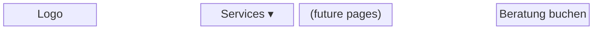

- `fixed inset-x-0 top-0 z-50`. It is transparent over the hero, with light text.
- **Condensed state** (preset `header-condense`, §9): after 80 px of scroll, a backdrop
  layer (`bg-forest-950/85 backdrop-blur-md`) fades in and the logo scales to 0.85. The
  header's height does not change, so there is no layout shift.
- A skip link comes first: "Zum Inhalt springen" → `#page`. It is `sr-only` and becomes
  visible on focus.
- `aria-current="page"` is set by `siteHeader` from the URL path, including after boosted
  navigation.

### 7.2 Services mega-menu (desktop, `lg` and up, `x-data="disclosure('menu-in','menu-out')"`)

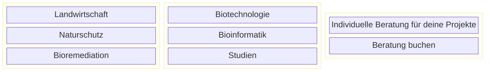

- The trigger is a `<button aria-expanded aria-controls>`. It opens on click or
  Enter/Space and on hover after 150 ms of intent. It closes on leaving (after 200 ms of
  grace), on Esc (focus returns to the trigger) and on a click outside.
- Links go to `/services/#<anchor>`. They are boosted, and anchor scrolling happens after
  the swap.

### 7.3 Mobile menu (below `lg`)
- A hamburger `<button>` opens a full-height panel from the right. The panel is a native
  `<dialog>` driven by `x-data="dialog('offcanvas-in','offcanvas-out')"`. The background
  is `forest-950` and the links are large `font-display text-4xl`.
- `showModal()` makes the page behind the panel inert. Esc closes the panel with its exit
  animation, and focus returns to the hamburger.

### 7.4 Footer (`src/_includes/footer.html`)
- `bg-forest-950 text-mycelium-50`. It holds the logo, a short tagline, social icon links
  (YouTube, LinkedIn, Facebook, Instagram, each with an `aria-label`), Datenschutz,
  Impressum and © year.

### 7.5 Shared dialog (`src/_includes/dialog.html`)
This is a single native `<dialog>` (`x-data="dialog"`, default transitions `dialog-in` /
`dialog-out`). It hosts three kinds of fragment, all loaded into `#dialog-body`: team
bios, press videos and the investment form.

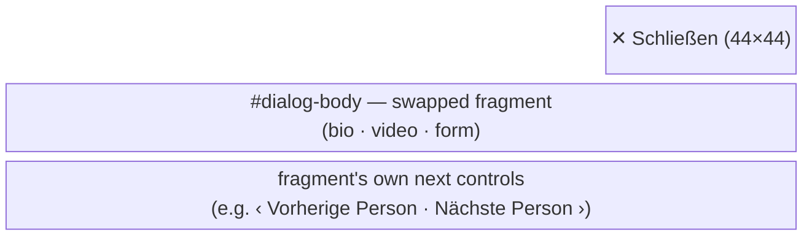

- The panel is `max-w-3xl rounded-2xl`. The `::backdrop` is
  `backdrop:bg-forest-950/70`. It appears instantly, because GSAP cannot animate
  pseudo-elements.
- The dialog opens on `htmx:after-settle` of `#dialog-body`. If it is already open, the
  new fragment replaces the old one in place with the `appear` preset. This is how
  previous/next bio navigation works.

## 8. Home page, section by section

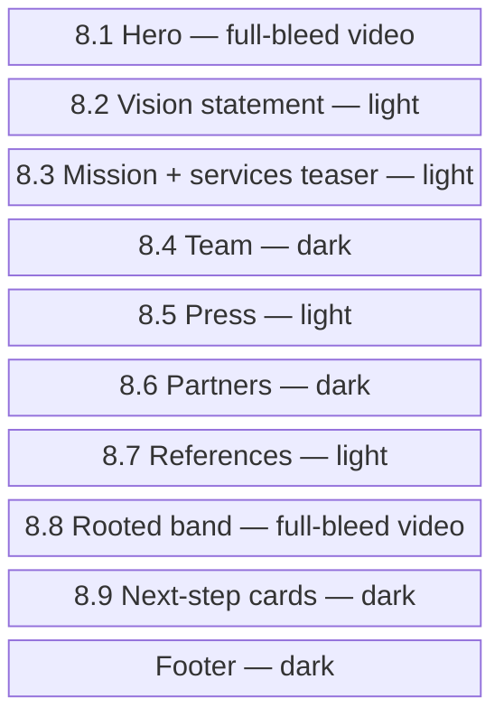

### 8.1 Hero (`#hero`, `x-data="ambientVideo"`, `data-anim="hero-intro"`)

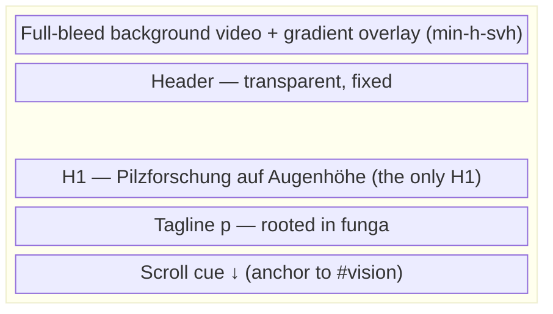

- `relative min-h-svh overflow-hidden`. The video is `absolute inset-0 h-full w-full
  object-cover` and sits under a gradient overlay
  (`bg-gradient-to-b from-forest-950/40 via-forest-950/20 to-forest-950/80`).
- The poster image is the LCP element. The video source is attached by `ambientVideo`
  only if motion is allowed and Save-Data is off. It pauses when offscreen.
- The scroll cue is a plain anchor, `<a href="#vision">`, labelled "Zum nächsten
  Abschnitt". Smooth scrolling comes from `motion-safe:scroll-smooth` on `<html>`
  (coding.md §6).

### 8.2 Vision statement (`#vision`, light surface)
- A single large paragraph styled as the vision statement.
- `data-anim="scrub-words"`. Words brighten from faint to full as you scroll through the
  section.

### 8.3 Mission (`#mission`, light surface, continued)

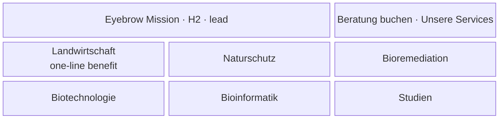

- Eyebrow "Mission", H2 "Wir bringen die Eigenschaften der Pilze zur Anwendung.", a lead
  paragraph, and the CTA pair `[Beratung buchen]` (primary) and `[Unsere Services]`
  (secondary).
- **New compared with the original: a services teaser.** Six link tiles in
  `grid md:grid-cols-2 lg:grid-cols-3`, each linking to `/services/#…`, with
  `data-anim="fade-up"` on the grid.

### 8.4 Team (`#team`, dark surface)

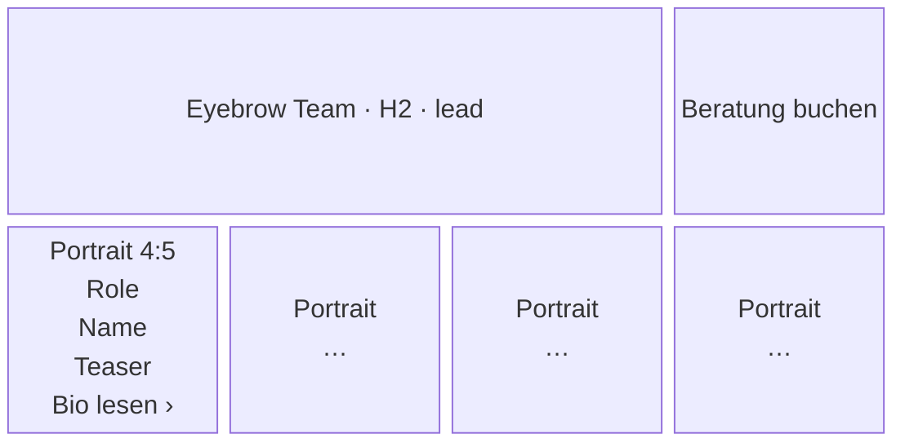

- Grid: `grid gap-8 sm:grid-cols-2 lg:grid-cols-4`. Each card is an `<article>`:
  - portrait (`aspect-[4/5] object-cover rounded-xl`, `data-anim="hover-zoom"`);
  - role and name;
  - a one-sentence teaser (inline, for SEO);
  - a LinkedIn icon link;
  - a "Bio lesen" `<button>` with `hx-get="/partials/team/<slug>.html"
    hx-target="#dialog-body" hx-swap="innerHTML"`.
- **HATEOAS:** each bio fragment ends with "‹ Vorherige Person" and "Nächste Person ›"
  controls targeting `#dialog-body`. The first and last bios omit the control that does
  not apply. The bio also carries its photo credit.

### 8.5 Press (`#presse`, light surface, `x-data="tabs(['highlights','tv','festspiele','archiv'],'highlights')"`)

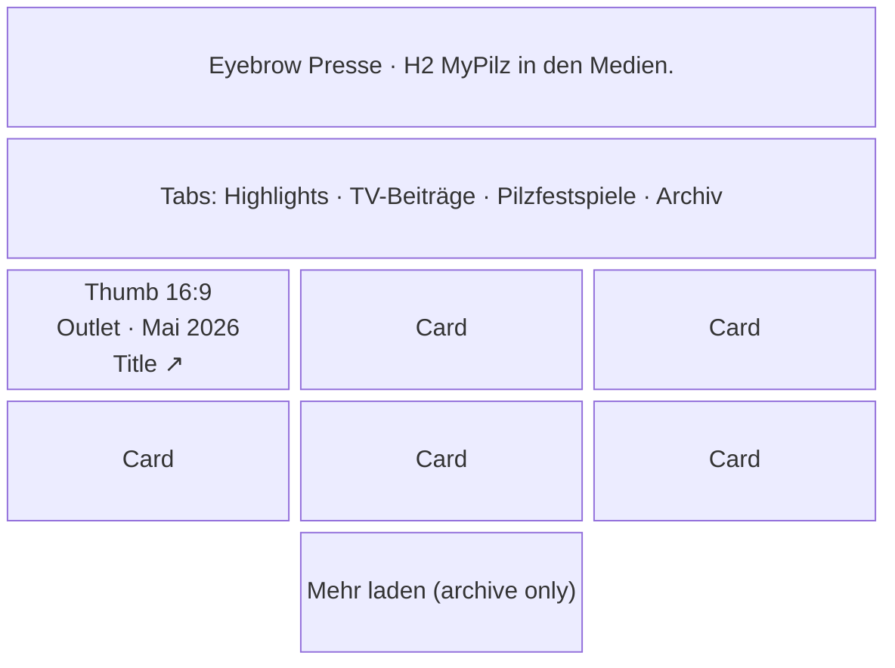

- The tablist has four tabs. The active tab has a chanterelle underline (`aria-selected:`
  variant).
- **Highlights is inline in the page.** The other panels are empty containers with
  `hx-get="/partials/press/<id>.html" hx-trigger="intersect once" hx-target="this"
  hx-swap="innerHTML"`, plus a skeleton indicator and a `<noscript>` note.
- **Archive pagination (HATEOAS):**
  - `archiv-1.html` ends with a "Mehr laden" button:
    `hx-get="/partials/press/archiv-2.html" hx-target="this" hx-swap="outerHTML"`.
  - Each page fragment returns its cards plus the next "Mehr laden" button.
  - The last page has none.
  - After the cards are appended, focus moves to the first new card. Each page fragment's
    first card carries `autofocus`, which htmx honours on settle.
- Each card has a 16:9 thumbnail, the outlet name and date, and the title as an external
  link. Dates use one format everywhere ("Mai 2026") and come from one source per item.
- Video cards have a play button that loads `/partials/media/<slug>.html` into the
  dialog. The video has `controls` and never autoplays.
- Each item appears in exactly one tab. Highlights is a curated subset, and Archiv is
  everything older.

### 8.6 Partners (`#partner`, dark surface)
- Eyebrow "Partner", H2 "Mit einem starken Netzwerk als Fundament.", a lead paragraph.
- A logo row (`data-anim="marquee"`) that moves horizontally **as you scroll** through
  the section, rather than auto-playing. The preset clones the list once
  (`aria-hidden="true"`, links in the clone get `tabindex="-1"`).
- Logos are `h-10 w-auto`, monochrome via `grayscale` and full colour on hover and focus
  (an instant swap). Each logo **links to the partner's website** with `alt` set to the
  partner's name.
- With reduced motion, the logos show as a static wrapped flex row. The clone is not
  created.

### 8.7 References (`#referenzen`, light surface, `x-data="carousel(7)"`)

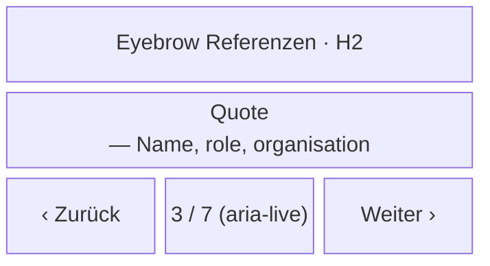

- One quote is visible at a time, in a `figure`/`blockquote`/`figcaption`. Prev and next
  buttons and left/right arrow keys move between quotes. There is no autoplay.
- Quotes are set in `font-display text-2xl md:text-3xl`, with up to about 60 characters
  per line.

### 8.8 Rooted band (`#rooted`, full-bleed video, `x-data="ambientVideo"`)
- Second background video with an overlay. Centered giant type: `Rooted in` + a cycling
  word: `funga` → `flora` → `fauna` (preset `word-cycle`).
- With reduced motion the line shows "Rooted in funga, flora, fauna." statically.
- The video loads only when the section approaches the viewport.

### 8.9 Next-step cards (dark surface)

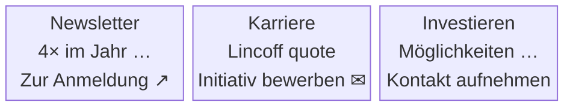

- `grid gap-6 md:grid-cols-3`.
- **Newsletter:** an external link to the provider's hosted double opt-in page.
- **Karriere:** `mailto:` with the subject "Initiativbewerbung", because applications
  include attachments.
- **Investieren:** a `<button>` with `hx-get="/partials/forms/investieren.html"
  hx-target="#dialog-body" hx-swap="innerHTML"`. It opens the investment form in the
  dialog (§10.3).
- The Newsletter and Karriere cards are whole-card links (a stretched `<a>`). The
  Investieren card's button is the control.

## 9. Motion specification

**Philosophy:**
- One signature moment: the hero intro.
- Two scroll-driven storytelling moments: the vision words and the partner marquee.
- Everything else is quiet. Entrance reveals apply to section headers and card groups
  only.
- Motion that answers a user action (menus, dialog, tabs, carousel, form results, "Mehr
  laden") is quick and shows what changed.

| Preset / transition | Element | Trigger | Spec | Reduced motion |
|---|---|---|---|---|
| `hero-intro` | `#hero` | Mount | Timeline: poster → video crossfade 0.8 s; H1 split into lines (`mask: 'lines'`), `yPercent: 100 → 0`, stagger 0.12, 0.9 s, `power4.out`; tagline `autoAlpha` 0 → 1 at +0.4 s; header `yPercent: -100 → 0` 0.6 s; scroll cue last | Everything visible, video not loaded |
| `scroll-cue` | Hero cue | After intro | `y: 0 → 8`, `yoyo`, `sine.inOut`, 1.2 s, **repeat 3, then rest** (WCAG 2.2.2) | Static |
| `header-condense` | Header | Scroll position 80 px | Backdrop `autoAlpha` 0 → 1, logo `scale` 1 → 0.85, 0.3 s; reversed on the way back | Instant toggle |
| `scrub-words` | Vision statement | Scroll scrub | SplitText `words`; `opacity: 0.15 → 1`, stagger along the scroll range, `scrub: 0.5`, start `top 80%`, end `bottom 55%` | Not split, full opacity |
| `fade-up` | Section header stacks, card grids, appended archive cards | Enter viewport, once | `y: 24 → 0`, `autoAlpha` 0 → 1, 0.6 s, `power2.out`, batch stagger 0.08 | Visible |
| `appear` | Swapped-in results: form success/error, dialog body replacement | Mount (no scroll trigger) | `autoAlpha` 0 → 1, `y: 8 → 0`, 0.3 s, `power2.out` | Visible |
| `hover-zoom` | Team portraits, press thumbnails | Pointer enter/leave, focus within | `gsap.quickTo` scale 1 ↔ 1.04, 0.4 s, `power2.out` | None |
| `marquee` | Partner logo track | Scroll scrub through `#partner` | Track `xPercent: 0 → -50` (two copies), `scrub: 1` | Static wrapped row, no clone |
| `word-cycle` | Rooted band word | Enter viewport, once | Mask in `yPercent: 100 → 0`, hold 1.2 s, mask out `-100`; one pass funga → flora → fauna → **rests on funga** (≈ 5 s) | Static sentence |
| `page-out` | `#page` | Boosted navigation (beforeSwap) | `autoAlpha` 1 → 0, `y: 0 → -12`, 0.25 s, `power2.in`. Must be ≤ `config.motion.pageMs` (300 ms, which matches `swap:300ms`). | Instant |
| `page-in` | New `#page` | After settle | `autoAlpha` 0 → 1, `y: 12 → 0`, 0.4 s, `power2.out` | Instant |
| `menu-in` / `menu-out` | Mega-menu panel | Toggle | In: `autoAlpha`, `y: -8 → 0`, 0.25 s. Out: 0.15 s. | Instant |
| `offcanvas-in` / `offcanvas-out` | Mobile panel | Toggle | Panel `xPercent: 100 → 0`, 0.45 s, `power3.out`; links `y: 16 → 0` stagger 0.05. Out: 0.3 s. | Instant |
| `dialog-in` / `dialog-out` | Dialog panel | Open/close | In: `autoAlpha`, `y: 24 → 0`, `scale: 0.98 → 1`, 0.35 s, `power3.out`. Out: 0.2 s, `power2.in`. | Instant |
| `panel-in` | Press tab panel | Tab change | `autoAlpha` 0 → 1, `y: 8 → 0`, 0.25 s | Instant |
| `slide-change` | Testimonial | Prev/next | Outgoing: `autoAlpha` → 0, `x: ∓24`, 0.2 s. Incoming: `autoAlpha` 0 → 1, `x: ±24 → 0`, 0.35 s. | Instant swap |

The timings above are starting values. Tune them against the original **(verify)** and
update this table when they change.

## 10. Other pages and forms

### 10.1 Services (`/services/`)
- A compact hero (`min-h-[60svh]`, static image) with H1 "Services" and a lead paragraph.
- Six sections, with the anchors `#landwirtschaft`, `#naturschutz`, `#bioremediation`,
  `#biotechnologie`, `#bioinformatik` and `#studien`. They alternate image and text on
  `lg` and stack on mobile.
- Each section has an H2, the problem it solves, the approach, typical deliverables and a
  "Beratung buchen" CTA. The CTA is a plain link to `/beratung/`, with no query
  parameters (HATEOAS).

### 10.2 Beratung (`/beratung/`)

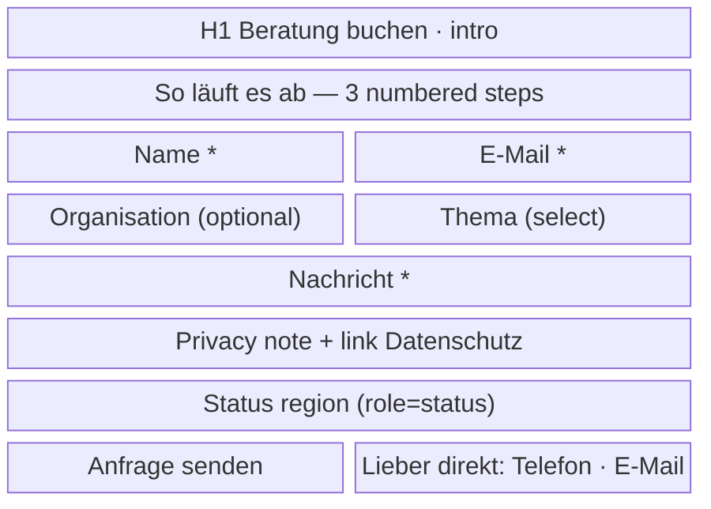

- The form markup lives in `/partials/forms/beratung.html` and is included inline at
  build time. The same fragment is reused by the "Neue Anfrage" control.
- **Fields:**
  - Name (required);
  - E-Mail (required, `type=email`, `autocomplete=email`);
  - Organisation (optional);
  - Thema, a select with Landwirtschaft, Naturschutz, Bioremediation, Biotechnologie,
    Bioinformatik, Studien, Forschungskooperation and Sonstiges;
  - Nachricht (required);
  - hidden fields `_subject` ("Beratungsanfrage") and the honeypot `_gotcha`.
- Mark optional fields "(optional)". Do not mark required fields with asterisks only.
  Required fields use the `required` attribute and native validation.
- "So läuft es ab" uses three numbered steps. This is a real sequence, so numbering is
  appropriate.

### 10.3 Investment enquiry (fragment in the dialog)
- `/partials/forms/investieren.html`: an H2 "In MyPilz investieren", one line of context,
  and the fields Name, E-Mail, Organisation (optional) and Nachricht (optional), plus
  `_subject` ("Investment-Anfrage") and `_gotcha`.
- It uses the same form pattern and states as §10.4. On success, the next control is
  "Schließen", which closes the dialog. "Neue Anfrage" is not offered.

### 10.4 Form states (all off-site forms)

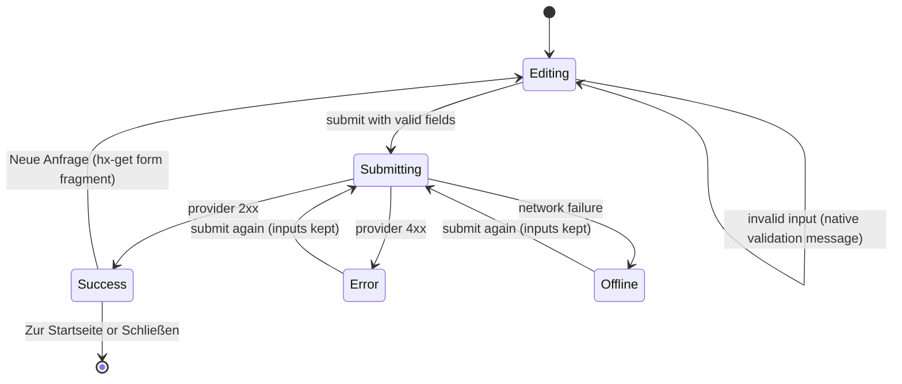

| State | What the user sees | Controls present |
|---|---|---|
| Editing | Form with labels and hints. The status region is empty. | Submit |
| Submitting | The submit button is disabled (`hx-disabled-elt`) and its label area shows the indicator "Wird gesendet …". Inputs stay editable. | None new |
| Success | The whole form is replaced by the success fragment: heading "Danke, deine Anfrage ist angekommen.", one sentence on what happens next `[Platzhalter: Reaktionszeit]`, plus `appear` motion. | "Neue Anfrage" and "Zur Startseite" (page), or "Schließen" (dialog) |
| Error | The form stays with its inputs. The status region shows "Deine Anfrage wurde nicht gesendet." plus a list of provider messages, each linking to its field when a field is named. Focus moves to the status heading. | Submit (again) |
| Offline | Same as Error, with "Keine Verbindung zum Formulardienst. Prüf deine Internetverbindung und sende erneut – oder schreib an [E-Mail]." | Submit (again), `mailto:` link |
| No JavaScript | Native POST to Formspree, followed by the provider's confirmation page. | Provider-defined |

## 11. Performance and media budget

| Asset | Budget |
|---|---|
| Hero video | WebM (VP9 or AV1) ≤ 3 MB plus MP4 (H.264) fallback ≤ 4 MB; ≤ 1920×1080 (mobile source ≤ 1280×720); 8–15 s loop; no audio track |
| Band video | Same budget; loaded only near the viewport |
| Hero poster (LCP) | AVIF ≤ 120 KB, WebP fallback; preloaded with `fetchpriority="high"` |
| Team portraits | AVIF ≤ 80 KB each at 800×1000 |
| Press thumbnails | AVIF/WebP ≤ 40 KB at 640×360 |
| Partner logos | SVG preferred, else PNG ≤ 15 KB |
| Fonts | ≤ 2 variable `.woff2` files, Latin subset, ≤ 150 KB total |
| JS (vendor + app) | ≈ 100 KB gzip total |
| CSS | ≤ 30 KB gzip |
| Fragments | ≤ 30 KB HTML each (archive pages hold about 9 cards) |
| Home initial transfer (excluding videos) | ≤ 1.2 MB |

Targets on mobile Lighthouse: Performance ≥ 90, Accessibility 100, Best Practices ≥ 95,
SEO 100; LCP < 2.5 s; CLS < 0.05.

## 12. Copy and voice
- Address visitors with **"du"** consistently.
- Use one name per action, everywhere:
  - "Beratung buchen" for navigation to the form;
  - "Anfrage senden" for submitting;
  - "Neue Anfrage" to start again;
  - "Mehr laden" for pagination;
  - "Bio lesen", "Vorherige Person" and "Nächste Person" for team bios.
- Use sentence case for buttons and headings. Eyebrows keep their uppercase styling
  through CSS, but the source text is written in sentence case.
- Errors say what happened and what to do next. They never apologise vaguely.
- All `alt` text, labels and ARIA labels are in German.

## 13. Accessibility notes specific to hypermedia
- Swapped content must announce itself or receive focus:
  - Form results move focus to the result heading.
  - Appended archive cards move focus to the first new card.
  - Dialog navigation moves focus to the new bio heading.
- The dialog's `aria-labelledby` points to the heading inside the current fragment. Every
  bio, video and form fragment has a heading with a stable id: `dialog-title`.
- Loading states are visible (the indicator) and do not trap focus.

## 14. Deliberate deviations from the original

| Original | Rebuild |
|---|---|
| Three `<h1>` elements on the home page; eyebrows marked up as `<h6>` | One `<h1>`; eyebrows are `<p>` |
| Home page never says what is on offer | Services teaser grid in Mission (§8.3) |
| "Sie"/"Du" mixed; two CTA labels | "du" throughout; one label per action |
| Many images with empty `alt` | Meaningful German `alt`; decorative media explicitly hidden |
| Partner logos link to their own image files | Logos link to partner websites |
| Press lists duplicated in markup; dates inconsistent | Each item in exactly one tab; paginated archive; one date source |
| Investment contact is a bare `mailto:` | Investment enquiry form in the dialog |
| Cart and webshop in the header of a B2B site | Removed (out of scope) |
| Leftover theme-demo links in the footer cards | Every link has a real destination |
| Fonts and media loaded from third parties | Self-hosted; the only third party is Formspree, and only on submit |
| Scroll cue and loops animate indefinitely | All automatic motion stops within 5 s or is driven by scroll |

## 15. Acceptance checklist (per page)
- [ ] Matches the section order, surfaces and components in this document.
- [ ] Every animation is listed in §9 and handles reduced motion.
- [ ] Keyboard-only walk-through works: skip link, menus, tabs, dialog (including bio
      prev/next), carousel, "Mehr laden", forms.
- [ ] Works without JavaScript: all content is visible, nav links work, lazy panels show
      their `<noscript>` note, and forms submit natively.
- [ ] **HATEOAS:** every fragment shows its own next controls, and unavailable actions are
      absent. Running `grep` for URL strings in `src/js/` finds nothing except the origin
      allowlist.
- [ ] **Forms:** success, provider validation error, network failure (DevTools offline),
      honeypot filled, and no-JS submit all behave as in §10.4. Test submissions use the
      test form id.
- [ ] Media and performance budgets in §11 are met.
- [ ] No original MyPilz assets are used without permission (§2).
